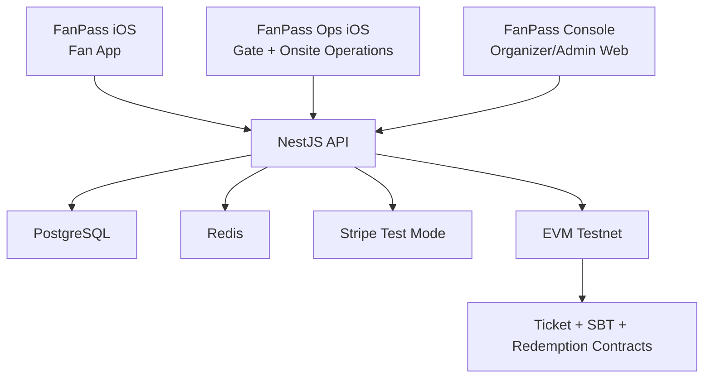

# FanPass Architecture

## System Shape

## Product Surfaces

FanPass is a three-surface product:

1. `FanPass` - consumer iOS app for fans.
2. `FanPass Ops` - separate iOS app for gate staff, onsite managers, and venue operations.
3. `FanPass Console` - web dashboard for organizers, admins, event setup, reporting, review, and risk operations.

The current codebase now includes a separate `FanPassOps` iOS target with its own bundle id and operational shell. The older `fanpass://staff/scanner` route has been removed from the fan app product path now that Ops covers the demo scanner flow.

## Surface Responsibilities

### FanPass

- Guest event discovery.
- Fan auth and profile.
- Primary ticket purchase.
- Ticket wallet and entry code display.
- Controlled resale marketplace.
- Fan access tasks and rewards.

FanPass must not expose staff scanner, organizer controls, inventory management, audit logs, or operational dashboards in default navigation.

### FanPass Ops

- Gate staff sign-in.
- Event and gate selection.
- Fast QR scanning.
- NFC tag-reading prototype.
- Manual lookup and exception handling.
- Live check-in counts and entry failure states.
- Offline/degraded-mode indicators in later versions.

FanPass Ops should be visually quieter and more operational than the consumer app. It prioritizes speed, high contrast status, and large touch targets over fan-facing brand moments.

### FanPass Console

- Organizer/admin event setup.
- Ticket type and inventory management.
- Order, refund, transfer, and resale oversight.
- Fan access task review.
- Risk, audit logs, and reporting.
- Settlement/payment operational views.

Console remains web-first because tables, configuration, reporting, and review workflows are better served by desktop-class layouts.

## Early Implementation Strategy

The backend is the source of operational truth during Technical Prototype and Alpha. Blockchain state is used for verifiable ticket ownership and redemption history, while personal data, payment records, risk signals, and seat details remain off-chain.

The orderbook is off-chain. This keeps matching fast, enables payment authorization before settlement, and allows risk checks, refunds, and dispute workflows.

Shared code should live in packages or shared iOS modules where it reduces real duplication:

- API models and request contracts.
- Brand tokens.
- Verification payload parsing.
- Basic networking helpers.

Do not share navigation or screen-level UI between FanPass and FanPass Ops when it weakens role clarity.

## NFC Strategy

QR is the universal entry method. NFC is added only in platform-supported ways:

- FanPass Ops-side Core NFC tag reading.
- NFC wristband/card reading for events that issue physical tags.
- Apple Wallet pass workflows where venue hardware supports them.

The product does not assume unrestricted iPhone card emulation.
