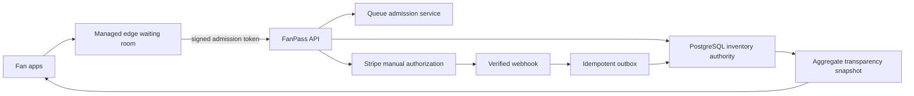

# FanPass High-Demand On-Sale Design V4

Status: implemented staging foundation; production edge admission still required
Date: 2026-07-12

## Decision Summary

FanPass uses a transparent, account-bound queue in front of atomic PostgreSQL inventory holds. The product should show enough aggregate data for a buyer to understand where inventory went without exposing seat-level inventory, identities, payment signals, or risk rules that attackers could exploit.

The staging implementation provides:

- a public allocation and inventory ledger;
- a private exact queue position for the signed-in account;
- the currently admitted queue range;
- a ten-minute checkout lease;
- PostgreSQL row locks for final-inventory contention;
- per-account purchase limits under the same lock;
- one queue place per account and app installation;
- HMAC-hashed Stripe card fingerprint linkage across accounts;
- Stripe manual capture, webhook authority, and idempotent outbox settlement;
- audit records for queue joins, admission, holds, authorization, conversion, release, and identity rejection.

This is the correctness layer. It is not yet the complete traffic-ingress layer for a stadium-scale sale. A managed edge waiting room must protect Render and Neon before a major public launch.

## Platform Benchmark

The following comparison uses official provider documentation. Product details can change, so re-check the linked sources before a production launch.

| Platform | High-demand mechanism | Useful pattern | Transparency gap FanPass should improve |
| --- | --- | --- | --- |
| Ticketmaster Smart Queue | Waiting room before sale, assigned queue position at opening, controlled admission, one account/device/browser guidance, and a limited turn window. | Randomize the prequeue, append later arrivals, do not require refresh, and use a checkout window. | Buyers see their place or estimate but not a complete live allocation ledger showing public allocation, held inventory, sold inventory, and admitted range. |
| AXS Waiting Room | Opens before the sale, filters traffic, and controls entry. Joining early does not create a first-come advantage before the sale begins. | A prequeue should not reward scripts that arrive milliseconds earlier. | The buyer still has limited visibility into inventory movement and allocation categories. |
| Ticketek Lounge | Controls traffic, discourages multiple tabs/devices, enforces ticket limits across identity and payment attributes, and releases timed-out baskets. | Link account, email, billing, and card signals; make cart expiry return inventory. | Allocation explanations exist, but live numerical movement through queue, holds, and sold inventory is limited. |
| SeatGeek | Uses a waiting room for high-demand events, randomizes users present at launch, then treats later arrivals in arrival order. | Randomized prequeue followed by FIFO is understandable and resists millisecond races. | Position does not guarantee a ticket and the inventory path is not fully visible. |
| DICE | Uses an ordered wait list for returned tickets and gives the next buyer a limited purchase window. Original buyers can receive a refund when the returned ticket sells. | Controlled official return/resale prevents an uncontrolled secondary market and creates a clear reallocation path. | DICE deliberately does not show an exact wait-list position, which reduces buyer visibility. |
| Eventbrite | Counts completed and pending orders against availability and supports organizer holds that remove inventory from sale. | Pending checkout must consume inventory so two buyers cannot purchase the same final ticket. | Organizer holds are operationally useful, but the buyer needs a clearer public split between sale allocation and non-public holds. |
| Cloudflare Waiting Room | Offers FIFO or random queueing, a prequeue, encrypted queue cookies, and estimated wait information at the edge. | Keep large traffic away from the origin and database; issue a signed admission token to a bounded cohort. | It is infrastructure rather than the ticket-allocation authority, so FanPass still needs its own inventory and fairness ledger. |

Official sources:

- [Ticketmaster Smart Queue](https://help.ticketmaster.com/hc/en-us/articles/9781366115985-What-is-the-Ticketmaster-Smart-Queue-)
- [AXS Waiting Room](https://support.axs.com/hc/en-us/articles/200745935-What-s-a-Waiting-Room)
- [Ticketek On-Sale FAQ](https://help.ticketek.com.au/hc/en-us/articles/360001862168-On-Sale-FAQs)
- [SeatGeek high-demand event queue](https://support.seatgeek.com/hc/en-us/articles/11181317039891)
- [DICE sold-out event Wait List](https://dicefm.zendesk.com/hc/en-gb/articles/4409669441169-Buy-tickets-to-a-sold-out-event-via-the-Wait-List)
- [DICE Wait List queue behavior](https://dicefm.zendesk.com/hc/en-gb/articles/4409662022289-How-the-Wait-List-queue-works)
- [Eventbrite pending orders and availability](https://www.eventbrite.com/help/en-us/articles/693972/tickets-are-still-available-but-people-are-on-the-waitlist-what-should-i-do/)
- [Eventbrite ticket and seat holds](https://www.eventbrite.com/help/en-us/articles/779653/)
- [Cloudflare queueing methods](https://developers.cloudflare.com/waiting-room/reference/queueing-methods/)
- [Cloudflare prequeue events](https://developers.cloudflare.com/waiting-room/additional-options/create-events/)
- [Cloudflare waiting-room cookie](https://developers.cloudflare.com/waiting-room/reference/waiting-room-cookie/)

## FanPass Transparency Contract

### Public fields

The public snapshot may expose only aggregate event data:

- venue capacity;
- public-sale allocation;
- named allocation categories and their quantities;
- available, held, sold, returned, and released-hold counts;
- aggregate counts by ticket category;
- waiting, admitted/in-checkout, completed, expired, and blocked queue counts;
- the current admitted queue-number range;
- waiting-room, opening, and closing timestamps;
- purchase limit and checkout-window length;
- allocation policy version and fairness commitment.

### Private account fields

Authenticated queue status may additionally expose:

- the account's exact queue number;
- users ahead;
- whether the position is finalized;
- a non-sensitive queue support reference;
- join attempt number;
- checkout eligibility and lease expiry.

### Never public

The API and UI must not expose:

- other buyers' account identifiers;
- exact seat-level unsold inventory;
- raw Stripe fingerprints or their stored HMAC hashes;
- app-installation identifiers or hashes;
- IP, device-attestation, phone, email, or billing-link signals;
- risk scores, block rules, thresholds, or manual-review notes;
- internal order, hold, payment, or queue-entry identifiers in a public response.

## Queue Ordering

1. Accounts joining before opening enter `PREQUEUE` without a final number.
2. At opening, the backend assigns positions by a deterministic HMAC key and stable tie breakers.
3. Accounts joining after opening are appended in FIFO order.
4. Admission advances in bounded batches while respecting `maxActiveCheckouts`.
5. A buyer receives a checkout lease, not ownership of a ticket.
6. Inventory becomes unavailable only after an atomic `inventory_holds` row is created.
7. An expired lease returns inventory and the account may rejoin at the end of the line.

The API publishes a fairness commitment and reveals the derived seed only after closure. This is a commitment, not a complete external proof: a production launch should timestamp/sign the commitment in an append-only transparency log before the waiting room opens.

## Atomic Inventory Rules

PostgreSQL is the inventory authority. The implementation maintains these invariants:

1. `sold + active holds + authorized holds <= ticket type supply`.
2. Primary order creation locks the ticket-type row before inserting the order and hold.
3. Competing buyers for the final ticket serialize on that row; exactly one transaction commits.
4. A queue-managed primary order requires a current `ADMITTED` or `CHECKOUT` lease.
5. Account purchase limits are checked while the same ticket-type lock is held.
6. Stripe authorization does not issue a ticket. A verified webhook authorizes the hold, then an outbox worker performs settlement.
7. A queue hold that expired cannot be reclaimed by a late webhook.
8. Ticket creation and hold conversion occur in one database transaction.
9. Failed issue/settlement releases inventory and requests payment-authorization cancellation or refund.
10. Repeated order, payment, webhook, and side-effect operations use stable idempotency keys.

Relevant primary references:

- [PostgreSQL row-level locking](https://www.postgresql.org/docs/17/explicit-locking.html)
- [Stripe manual capture](https://docs.stripe.com/payments/place-a-hold-on-a-payment-method)
- [Stripe idempotent requests](https://docs.stripe.com/api/idempotent_requests?lang=node)
- [Stripe webhook-based payment status](https://docs.stripe.com/payments/payment-intents/verifying-status)

## Simultaneous Purchase Decisions

### Two buyers request the final ticket

Both transactions may reach the API, but both must lock the same `ticket_types` row. The first transaction that validates capacity creates the hold and commits. The second transaction then sees the committed hold and receives `Ticket allocation is currently exhausted`. API arrival time alone does not decide ownership; committed atomic inventory does.

### One person uses multiple accounts

FanPass applies layered controls:

- one queue row per `(onsale, account)`;
- one queue row per `(onsale, app-installation hash)`;
- per-account purchase limit checked under lock;
- one linked account per Stripe card fingerprint for the configured sale;
- an event-scoped advisory lock around simultaneous use of the same card fingerprint;
- a queued card authorization cannot settle when the fingerprint signal is missing;
- HMAC-only storage for card and app-installation linkage signals;
- aggregate audit logs for support and investigation.

A failed identity decision blocks the hold, rejects the primary order, does not enqueue ticket issuance, and asynchronously cancels the Stripe authorization.

### Two accounts authorize the same card simultaneously

The event and fingerprint select one PostgreSQL advisory transaction lock. The first account may authorize; after it commits, the second transaction observes the linked account, blocks its hold, and requests authorization cancellation. The test suite executes these calls concurrently rather than sequentially.

### A payment webhook arrives after checkout expiry

For a queue-managed sale, the old hold remains expired. The webhook cannot reacquire returned inventory, cannot issue a ticket, and cannot invalidate a newer queue attempt. The authorization is retried only for transient identity-signal lookup failure; otherwise it is cancelled.

## Anti-Bot and Anti-Scalper Boundary

The current app-installation ID is stored in the iOS Keychain with `ThisDeviceOnly`. It is useful as one linkage signal but is not device attestation and must not be described as proof of one human. Reinstall, device farms, emulators, compromised clients, and multiple real cards remain possible.

Before a major public launch, add:

- Apple App Attest assertions bound to queue join and checkout;
- DeviceCheck as a fallback signal, not a sole decision;
- verified phone number and abuse-resistant account recovery;
- velocity and graph checks across account, device, card, IP/ASN, address, and behavior;
- challenge or review for medium risk instead of a single opaque hard block;
- organizer-configured household exceptions and an appeal/support path;
- signed risk-policy versions in audit logs;
- strict staff tooling so no operator can silently move a buyer or create inventory.

Do not publish exact risk weights. Publish the policy categories, buyer limits, reason class, and appeal path.

## Scale Architecture

Current Render/Neon staging is suitable for functional and moderate concurrency testing. It is not the origin architecture to expose directly to hundreds of thousands of clients polling every five seconds.

For a major launch:

1. Put Cloudflare Waiting Room, Queue-it, or an equivalent managed edge queue in front of the API.
2. Admit only a bounded cohort with a short-lived, signed, account-bound token.
3. Cache the public aggregate snapshot for a short interval; do not query PostgreSQL once per viewer.
4. Replace broad polling with SSE/WebSocket fan-out or adaptive polling through a cache layer.
5. Keep PostgreSQL as the final inventory authority; do not sell from edge counters.
6. Run load, failover, webhook-delay, database-lock, and provider-outage tests at more than expected peak traffic.
7. Publish signed allocation snapshots and fairness commitments to append-only storage.

The current service already reduces database contention by making queue progression single-flight with a non-blocking PostgreSQL advisory lock. Requests that do not acquire the progress lock read the latest committed snapshot instead of waiting behind the progression transaction.

## Current API

| Method | Path | Auth | Purpose |
| --- | --- | --- | --- |
| `GET` | `/onsales/events/:eventId/snapshot` | Public | Aggregate allocation, inventory, queue flow, and fairness commitment. |
| `GET` | `/onsales/events/:eventId/queue/me` | Fan/Admin | Public snapshot plus this account's private queue state. |
| `POST` | `/onsales/events/:eventId/queue/join` | Fan/Admin | Join/rejoin using the account and app-installation linkage signal. |

## Verification Coverage

`apps/api/test/onsales-prisma-concurrency.spec.ts` uses a real PostgreSQL database and proves:

- only one transaction reserves the final ticket;
- one app installation cannot hold queue places for two accounts;
- simultaneous orders cannot exceed the account limit;
- simultaneous accounts using one card fingerprint produce one authorized and one blocked hold;
- a late payment cannot reclaim an expired queue hold;
- a queued hold cannot authorize without a Stripe card identity signal.

`apps/api/test/payments.service.spec.ts` proves a rejected on-sale authorization queues cancellation and never queues order matching/ticket issuance.
