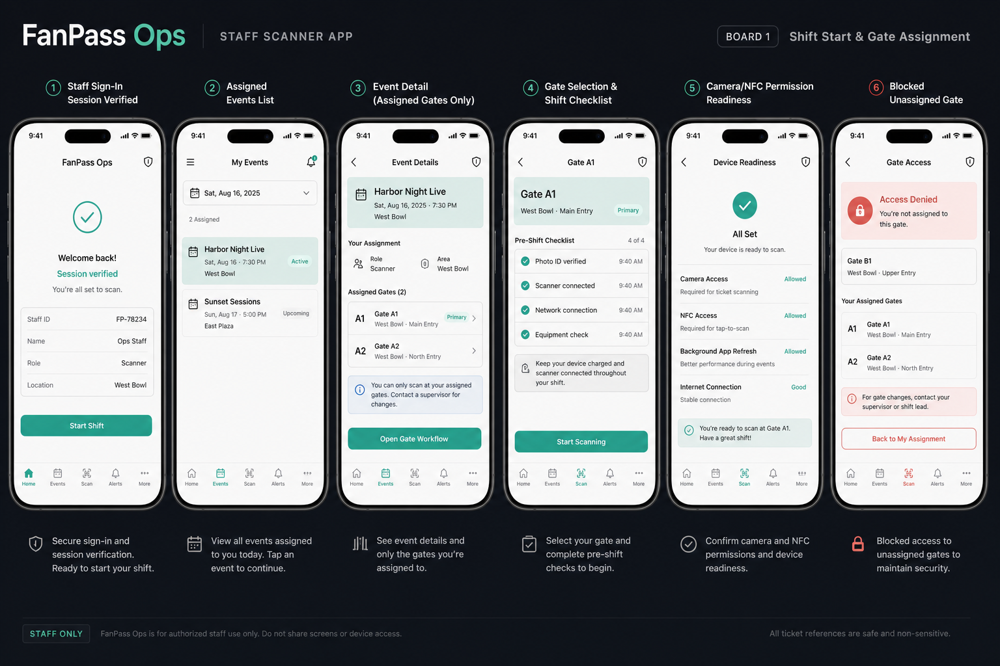
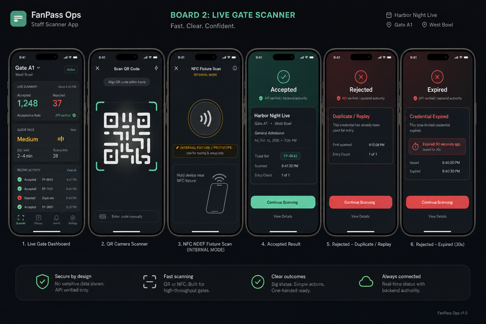
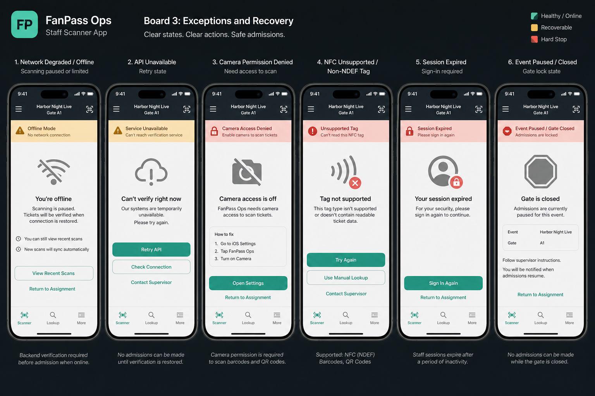
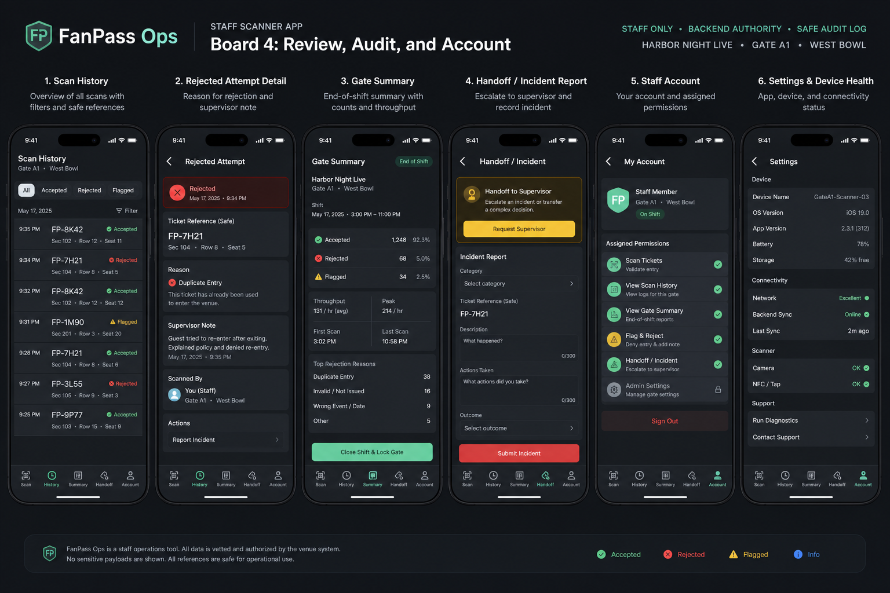
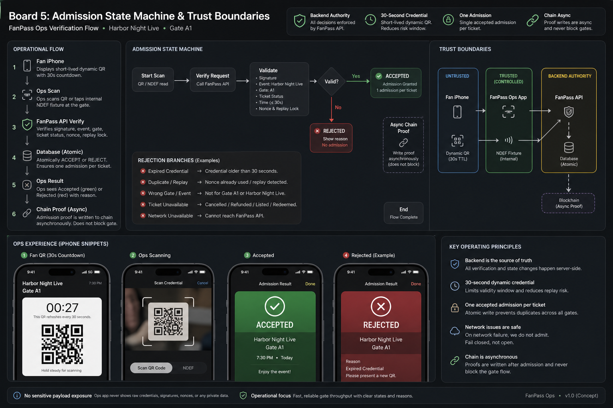

# FanPass Ops Concept Boards V4

Date: 2026-06-10

Status: concept-complete for the current FanPass Ops iOS direction. These boards are product and interaction references only. Generated image text is visual placeholder; production UI copy must be typed, reviewed, and kept consistent with the safety rules below.

## Scope

FanPass Ops is the staff-only iOS app for venue gate operations. It is separate from the consumer FanPass app and from the web organizer/admin console.

The concept set covers:

1. Shift start, verified staff session, assigned events, assigned gates, readiness checks, and blocked unassigned gates.
2. Live gate scanner, QR scan, internal NDEF fixture scan, accepted admission, duplicate/replay rejection, and expired 30-second credential rejection.
3. Exception and recovery states for network/API, camera permission, unsupported NFC tag, expired session, and paused/closed event.
4. Safe scan history, rejected-attempt detail, end-of-shift summary, incident handoff, staff account, and device health.
5. Admission state machine and trust boundaries for QR/NDEF capture, backend verification, atomic accept/reject, and asynchronous chain proof.

## Boards

### Board 1: Shift Start and Gate Assignment

Source image:

`/Users/tantalum/.codex/generated_images/019eaaab-aece-7d43-900a-29d8309612c4/confirmed-ops-01-shift-gate-assignment.png`

Implementation notes:

- Staff session must be verified before scanning.
- Event and gate lists must be assignment-scoped.
- Unassigned gates must be blocked, not merely hidden.
- Camera, NFC, background refresh, and network readiness should be explicit before shift start.

### Board 2: Live Gate Scanner

Source image:

`/Users/tantalum/.codex/generated_images/019eaaab-aece-7d43-900a-29d8309612c4/confirmed-ops-02-live-gate-scanner.png`

Implementation notes:

- The scanner must prioritize one-hand operation and large accepted/rejected states.
- QR display is a short-lived entry credential with a 30-second maximum TTL.
- NFC is an internal NDEF fixture/prototype path, not a fan-carried tag requirement.
- Accepted, duplicate/replay, and expired outcomes must come from FanPass API verification.
- Do not show raw payloads, signatures, nonces, full ticket ids, or wallet addresses.

### Board 3: Exceptions and Recovery

Source image:

`/Users/tantalum/.codex/generated_images/019eaaab-aece-7d43-900a-29d8309612c4/confirmed-ops-03-exceptions-recovery.png`

Implementation notes:

- Network/API failure must fail closed for new admissions.
- Camera permission denied must route to Settings and block scanning.
- Unsupported NFC tags must be handled as fixture errors, not as fan-facing ticket errors.
- Session expiry must require sign-in before more admissions.
- Paused or closed gates must block admission until server-side status changes.

### Board 4: Review, Audit, and Account

Source image:

`/Users/tantalum/.codex/generated_images/019eaaab-aece-7d43-900a-29d8309612c4/confirmed-ops-04-review-audit-account.png`

Implementation notes:

- Scan history should use safe ticket references only.
- Rejected-attempt detail may show reason, time, gate, and safe ref, but not sensitive payload data.
- End-of-shift summary should emphasize counts, rejection reasons, throughput, and handoff.
- Staff account must show assigned permissions and device health, not admin inventory controls.

### Board 5: Admission State Machine and Trust Boundaries

Source image:

`/Users/tantalum/.codex/generated_images/019eaaab-aece-7d43-900a-29d8309612c4/confirmed-ops-05-admission-state-machine-trust.png`

Implementation notes:

- Backend API and database state are the admission authority.
- The client may refresh QR presentation, but the backend must reject stale, superseded, duplicate, wrong-event, wrong-gate, cancelled, refunded, listed, redeemed, or unavailable tickets.
- Atomic server-side acceptance must enforce one accepted admission per ticket across gates/devices.
- Chain proof is asynchronous and must never block the gate decision.

## Hard Boundaries

- Do not add consumer marketplace, checkout, wallet management, organizer inventory, or admin dashboard flows into FanPass Ops.
- Do not expose raw QR payloads, signatures, nonces, owner ids, full ticket ids, wallet addresses, payment provider internals, Apple signing material, device identifiers, or real personal data.
- Do not present physical QR/NFC validation, TestFlight release, Apple Wallet pass signing, or chain custody as completed evidence until the matching validators pass with saved evidence files.
- Do not treat generated image text as production copy.
- Do not require fans to carry NFC/RFID tags for admission.
