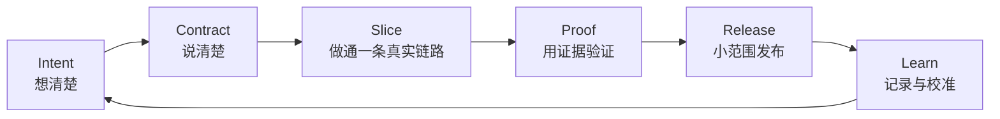

# Commercial Vibe Coding OS

这套文档把 FanPass 从想法、学校原型、全栈实现、真实设备验证、第三方服务接入，到商业化发布准备的经历，整理成一套可以复用的产品开发系统。

它不是“让 AI 一口气生成整个 App”的提示词集合。它的目标是让一个非传统工程背景的产品发起人，也能和 AI、设计师、工程师及外部服务商一起，把模糊想法稳定推进为可验证、可维护、可运营的商业产品。

## 四份文档各自负责什么

| 文档 | 用途 | 什么时候读 |
| --- | --- | --- |
| [FANPASS_JOURNEY.md](FANPASS_JOURNEY.md) | FanPass 持续更新的进展、尝试、问题、调整与经验 | 想了解项目如何一步步形成时 |
| [COMMERCIAL_PROJECT_PLAYBOOK.md](COMMERCIAL_PROJECT_PLAYBOOK.md) | 从想法到商业发布的可复制路径和阶段门 | 启动项目、规划下一阶段时 |
| [TEMPLATES.md](TEMPLATES.md) | 项目启动、任务、决策、Bug、发布和复盘模板 | 每次实际工作时直接复制 |
| 本文件 | 使用说明和维护规则 | 第一次进入或交接时 |

## 核心循环

这六步可以缩写成 `ICSPRL`，实际使用时记住中文即可：

> 想清楚 -> 说清楚 -> 做通 -> 证实 -> 发布 -> 记录与校准

商业 Vibe Coding 的速度来自缩短这个循环，而不是省略中间步骤。

## 三层记录法

为了既保留所有经历，又不把项目文档写成无法阅读的流水账，记录分三层：

1. **原始证据层**：Git 提交、Issue、测试输出、部署记录、截图、监控和供应商账单。它回答“当时到底发生了什么”。
2. **项目经历层**：`FANPASS_JOURNEY.md` 按阶段记录目标、尝试、遇到的问题、判断变化、当前结果和下一步。它回答“项目正在怎样形成，为什么这样决定”。
3. **可复制方法层**：Playbook 和模板把项目特有经验改写为通用规则。它回答“下一个项目应该怎么更顺畅地做”。

不把每段聊天复制进文档，也不靠聊天记录作为唯一事实来源。一次重要工作至少要落下一项可长期保存的证据。

## 使用方式

### 启动一个新项目

1. 复制 `TEMPLATES.md` 中的“项目启动契约”。
2. 使用 Playbook 的 Stage 0 到 Stage 2，不要直接跳到完整功能清单。
3. 先选一条端到端真实链路，再决定技术栈。
4. 建立最小文档集：`README`、`HANDOFF`、`ARCHITECTURE`、`ROADMAP`、`TASKS`、`QA`、`JOURNEY`。
5. 明确哪些状态由服务端、支付商、链或设备最终裁决。

### 每次和 AI 开始工作

1. 读取当前 Handoff 和任务相关契约。
2. 用任务模板写清结果、边界、非目标、风险和验收。
3. 先检查现状和运行证据，再改代码。
4. 完成后验证代码、测试、运行时和用户体验四个层次。
5. 更新 Handoff，并在 Journey 追加本次有意义工作的简短进展；阶段结束时再做一次归纳总结。

### 每周阶段总结

1. 哪些“完成”只有代码证据，没有运行证据？
2. 哪些 Bug 被误判过，真正根因在哪一层？
3. 哪些原型捷径正在接近真实用户？
4. 哪些成本、合规、安全或运维问题会在下一阶段突然变成阻塞？
5. 本周哪条经验可以加入 Playbook，避免下个项目再踩一次？

## 事实与边界

- `FANPASS_JOURNEY.md` 是持续更新的在建记录，不是已经完结的项目复盘，也不是逐条聊天转录。
- FanPass 的 Git 历史从 2026-05-30 开始；此前的学校项目来源保存在 `archive/school-project/`。
- 截至 2026-07-23，Journey 已依据学校项目报告、全部 144 个 Git 提交、当前产品文档和已记录的用户运行反馈回填，并记录安全 RC `a25185d2747520303eac0fd2681017b5c35ac62b` 已推送但未合并/部署、97/97 本地门禁、0 P0/P1 独立复核，以及 Hosted 403 和真实 Staging/Provider/链/设备证据仍开放的边界。
- 没有写入仓库、截图或发布证据的口头过程，不会被伪装成已证实事实。
- 新项目可以复制方法和模板，不能盲目复制 FanPass 的供应商、地域、Web3 或技术选型。

## 维护规则

有意义的产品或工程工作结束后：

- 更新项目 Handoff 的当前状态；
- 更新现有产品/技术契约，而不是每次新建一个文件；
- 每次有意义的产品或工程工作都在 Journey 留下简短进展；出现重要转向或阶段变化时再增加完整总结；
- 只有当经验跨项目成立时，才升级到 Playbook；
- 用 Git 保存历史，不把当前状态文档变成无限增长的聊天日志；
- 不记录密钥、Token、私人信息、原始支付数据或可被滥用的反作弊阈值。

## 成功标准

这套系统有效，不是因为文档很多，而是因为它让团队能够持续回答：

- 现在真正可用的是什么？
- 哪个系统拥有最终状态？
- 下一步为什么是这一步？
- 当前进展有什么证据，哪些部分仍在进行？
- 如果出现问题，如何定位、回滚和恢复？
- 下一个项目如何少走一次弯路？
